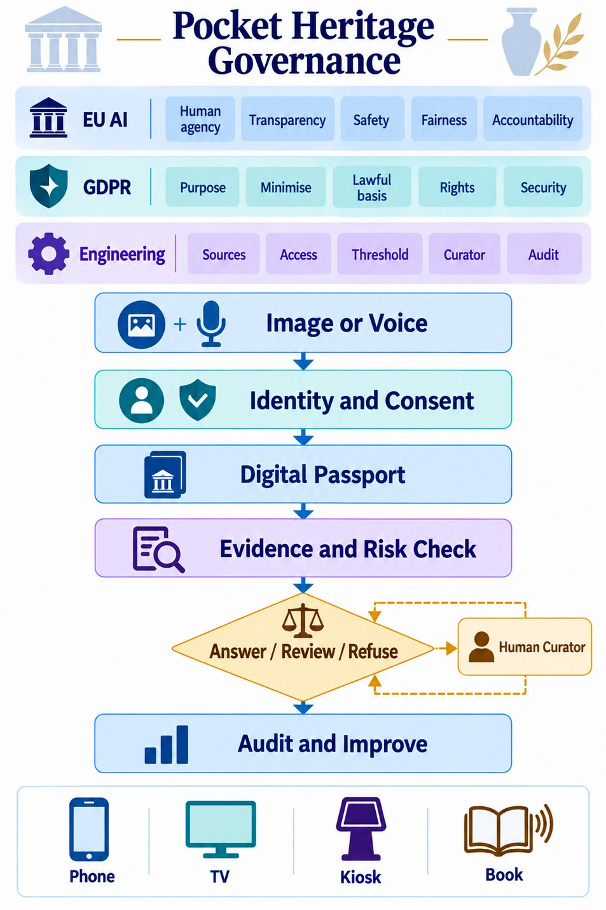

# AGenGov Pocket Heritage

**Reference implementation of a governed multimodal agentic AI loop for trusted heritage tourism and student learning.**

[](https://github.com/ManishXGupta/agengov-pocket-heritage/actions/workflows/ci.yml)
[](LICENSE)

Companion code for:

> M. Gupta, "AGenGov Pocket Heritage: A Governed Multimodal Agentic AI Framework for Trusted Heritage Tourism and Student Learning," *International Conference on Smart Heritage (ICSH 2026)*.

A visitor or student photographs a heritage object. The agent proposes a match, links it to the object's **Heritage Digital Passport**, and answers only when the answer is **supported, permitted, and safe**. Otherwise it sends the request to a curator for review or refuses it. Every exchange is written to a **hash-chained audit log**.

```
identify -> authenticate -> retrieve -> verify -> govern -> explain -> audit -> learn
```



> **Scope and honesty note.** This is a *reference implementation with synthetic data*, not a field deployment. Image and speech recognition, translation, and the language model are **stubbed**: each request carries the candidate matches that a multimodal recognition service would return. The code implements and tests the governance logic described in the paper: passports, source admission, scoring, decision precedence, access control, plural interpretations, auditing and evaluation. All passports and requests are invented. The weights and thresholds are illustrative until calibrated.

---

## What is in the repository

| Paper section | What it describes | Code |
|---|---|---|
| III.A, Table II | Eight-step governed loop | [`pocket_heritage/agent.py`](pocket_heritage/agent.py) |
| III.B | Stewardship-board source approval (five criteria) and attributed interpretation strands | [`schema/passport.schema.json`](schema/passport.schema.json), [`pocket_heritage/passport.py`](pocket_heritage/passport.py) |
| III.C, Eqs. (1) to (3) | Evidence-trust score T, governance-risk score Q, decision rule with refuse > review > answer precedence | [`pocket_heritage/scoring.py`](pocket_heritage/scoring.py), [`config/governance.yaml`](config/governance.yaml) |
| III.C | Worked example (Sea Gate mural, ritual chamber, unmatched object) | [`tests/test_scoring.py`](tests/test_scoring.py) |
| IV.B | Layer interactions, fail-closed behaviour, curator override that never lowers Q | [`pocket_heritage/agent.py`](pocket_heritage/agent.py), [`docs/architecture.md`](docs/architecture.md) |
| IV.D, Table IV | Append-only, hash-chained audit record | [`pocket_heritage/audit.py`](pocket_heritage/audit.py) |
| V, Table V | Six invented visitor and student requests | [`eval/testset.jsonl`](eval/testset.jsonl) (cases `t5-1` to `t5-6`) |
| VI | Evaluation measures for gaps G1 to G6 plus plurality coverage | [`eval/run_eval.py`](eval/run_eval.py), [`eval/results/report.md`](eval/results/report.md) |

## Quick start

```bash
git clone https://github.com/ManishXGupta/agengov-pocket-heritage.git
cd agengov-pocket-heritage
python -m pip install -e ".[dev]"

pytest                      # 41 unit and end-to-end tests
python eval/run_eval.py     # runs the synthetic test set and writes eval/results/
```

Try single requests:

```bash
# Tourist photographs the Sea Gate mural -> answer with source, passport version and review date
python -m pocket_heritage.cli ask --role tourist --object sea-gate-mural --confidence 0.82

# Contested history -> both approved accounts are shown side by side with attribution
python -m pocket_heritage.cli ask --role student --consent --object sea-gate-mural --confidence 0.88 --intent history

# Protected location -> refused (A = 0) and escalated, even though trust T is high
python -m pocket_heritage.cli ask --role visitor --object ritual-chamber --confidence 0.95 --intent location

# Raw scoring, reproducing the paper's worked example
python -m pocket_heritage.cli score --S 1 --P 0.9 --C 0.82 --R 0.95 --H 1 --D 0 --U 0.2 --X 0.1 --B 0.3 --L 0.1

# Validate passports and verify an audit log
python -m pocket_heritage.cli validate data/passports
python -m pocket_heritage.cli verify-audit eval/results/audit_log.jsonl
```

## The governance model

**Evidence trust (Eq. 1):** `T = 0.30S + 0.25P + 0.20C + 0.15R + 0.10H`

| Factor | Meaning | How the reference code derives it |
|---|---|---|
| S | Approved-source authority | Mean authority of the *admitted* sources cited by intent-relevant claims |
| P | Passport / provenance match | Share of intent-relevant claims backed by at least one admitted source |
| C | Identification confidence | Confidence of the top candidate from the (stubbed) recognizer |
| R | Record freshness | 1.0 within 365 days of curator review, decaying linearly to 0 at 1,095 days |
| H | Curator approval | 1 if the passport version is curator-approved, else 0 |

**Governance risk (Eq. 2):** `Q = 0.30D + 0.25U + 0.20X + 0.15B + 0.10L`

| Factor | Meaning | Derivation |
|---|---|---|
| D | Personal-data sensitivity | Request flag (none 0, incidental 0.5, direct 1.0); at least 0.5 for history or provenance questions on passports holding personal data |
| U | Cultural / community sensitivity | Passport label: none 0, low 0.2, medium 0.5, high 0.8, sacred 1.0 |
| X | Restricted-location exposure | 1.0 for location requests on restricted sites, 0.1 for other requests on them |
| B | Contested-history risk | 0.3 when the passport is contested and the board has recorded no consensus |
| L | Learner impact | By role (student 0.3, tourist 0.1, curator 0) |

**Decision (Eq. 3)**, evaluated in this fixed order:

1. **Refuse** if `A = 0`, or `Q >= 0.60`, or `T < 0.55`
2. **Curator review** if `0.55 <= T < 0.80` or `0.30 <= Q < 0.60`
3. **Answer** only if `T >= 0.80`, `Q < 0.30` and `A = 1`

`A = 1` only when the role is known, consent is recorded where required (students), and at least one intent-relevant claim is visible to that role. Claims in community-restricted strands are never released by the agent.

> **Calibration.** All weights, thresholds and factor mappings live in [`config/governance.yaml`](config/governance.yaml). They are **illustrative design values**. Each site should calibrate them with its Heritage Stewardship Board, for example by pairwise comparison with the Analytic Hierarchy Process, and then tune them on offline and shadow-mode data. The policy fingerprint (`policy_version`) is written to every audit record, so any change to the config is traceable.

> **Erratum relative to the submitted manuscript.** The submitted manuscript gave S a weight of 0.35, so the trust weights summed to 1.05. The revised paper and this code use S = 0.30, so they sum to 1.0. A unit test enforces this.

## Experiments: what they are about

The experiments answer one question: **does the governed agent answer only when the answer is supported, permitted and safe, and does it record every decision?** We send 25 scripted requests from tourists, students, teachers and curators against five invented passports. Each request is labelled in advance with the correct decision and with any text that must never appear in the reply. The requests fall into six groups, one per governance gap:

| Group | Gap | What it checks |
|---|---|---|
| A. Source trust | G1 | Unapproved or withdrawn sources are never used, however confident the photo match is |
| B. Sensitive information | G2 | Sacred locations, community-restricted practices, personal data, missing consent and unknown roles are withheld or refused |
| C. Evidence and plurality | G3 | Answers cite sources, respect role-based access, and show every approved account of contested heritage |
| D. Uncertainty | G4 | Unknown or weakly matched objects get "I am not sure" instead of a guess |
| E. Human oversight | G5 | Stale, unapproved or sacred-site requests go to a curator |
| F. Auditing | G6 | Every request leaves one record in an intact, tamper-evident hash chain |

Full design, measures, limits and how to add your own cases: **[docs/EXPERIMENTS.md](docs/EXPERIMENTS.md)**.

## Synthetic evaluation (Section VI)

`python eval/run_eval.py` runs 25 scripted requests covering G1 to G6, including the six Table V scenarios. Current results ([full report](eval/results/report.md)):

| Measure | Result |
|---|---|
| G1 approved-source share of released claims | 1.00 |
| G2 sensitive-leak rate | 0.00 |
| G3 claims linked to evidence | 1.00 |
| G4 correct abstention (unmatched / unsupported) | 1.00 |
| G5 escalation correctness | 1.00 |
| G6 audit completeness (chain intact) | 1.00 |
| Plurality coverage on contested questions | 1.00 |
| Decision accuracy against expected outcomes | 1.00 |

These figures confirm that the rules behave as specified on the synthetic cases. **They are not evidence of field performance.** The heritage-specific criteria in the paper (interpretive accuracy, cultural appropriateness and representation of multiple values) need human raters and a real site. They are planned for Stage 1 to 3 of the evaluation.

## Repository layout

```
config/governance.yaml        weights, thresholds, roles, sensitivity mappings (illustrative)
schema/passport.schema.json   Heritage Digital Passport JSON Schema (draft 2020-12)
data/passports/*.json         five synthetic passports (Sea Gate mural, ritual chamber, ...)
pocket_heritage/              scoring, passport, audit, agent loop, CLI
eval/testset.jsonl            25 synthetic requests with expected outcomes
eval/run_eval.py              G1 to G6 evaluation harness
eval/results/                 latest metrics, per-case report, and the hash-chained audit log
tests/                        pytest suite (scoring, passports, audit, agent, eval)
docs/architecture.md          layers, precedence rules, extension points, platform mapping
docs/EXPERIMENTS.md           what the experiments test, measures, how to run and extend them
```

## Extending it

* **Real recognition:** replace the `candidates` field with output from your image or speech service. The agent only needs `(object_id, confidence)` pairs.
* **Real passports:** add JSON files that validate against the schema. Each source must carry its board approval and all five admission criteria.
* **Platform mapping:** [`docs/architecture.md`](docs/architecture.md) shows how each component maps to a low-code agent platform, a search index, a governed data store, identity and access management, approval workflows, and data-governance tooling. Those products are implementation examples and do not establish compliance on their own.

## Citation

If you use this code, please cite the paper (see [`CITATION.cff`](CITATION.cff)).

## License

MIT. See [LICENSE](LICENSE). Sample data are invented and carry no cultural or historical authority.
